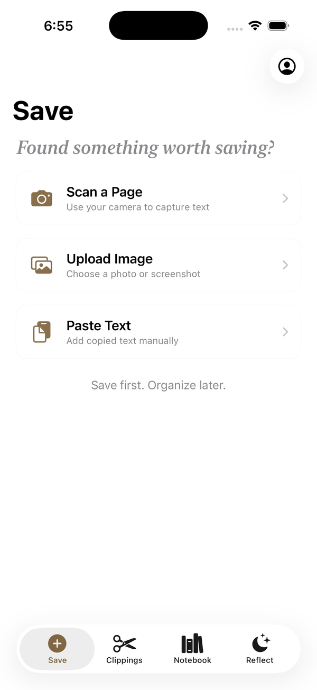
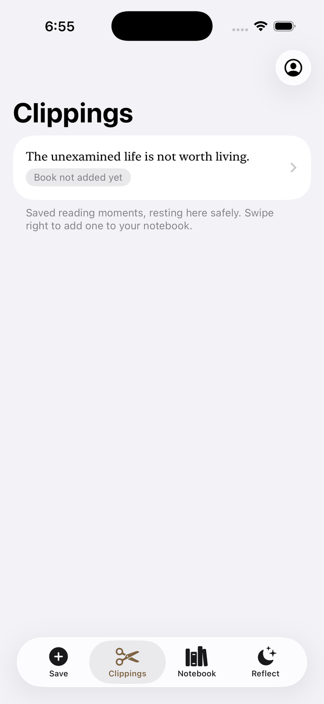
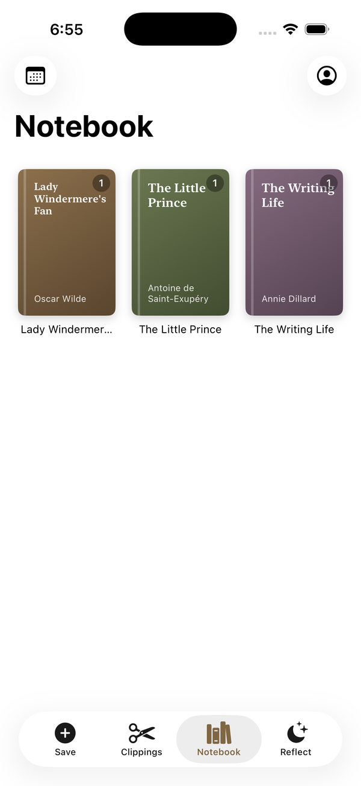
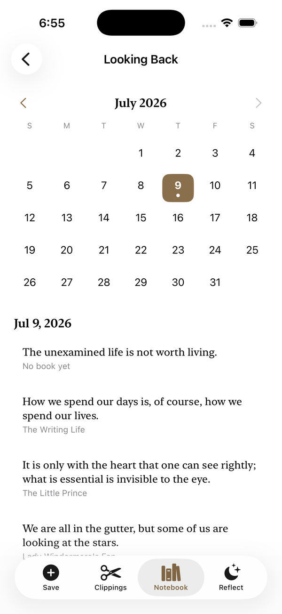
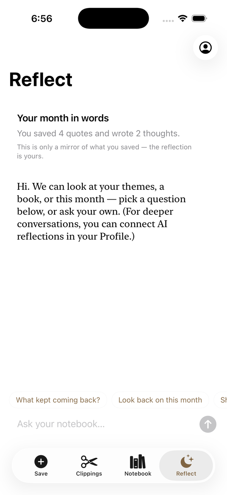
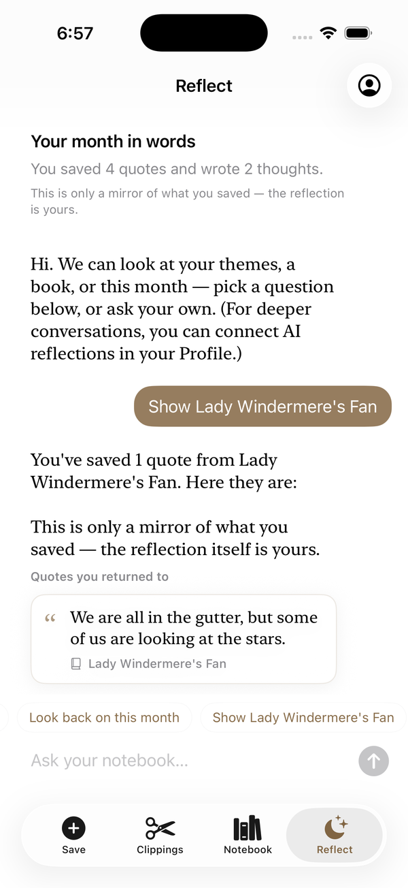
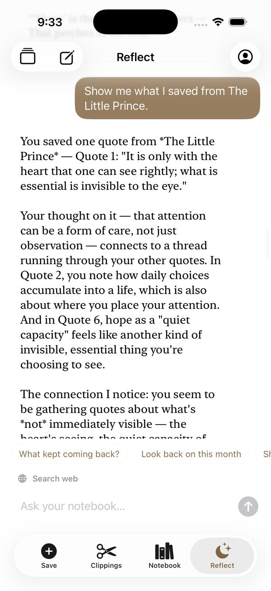
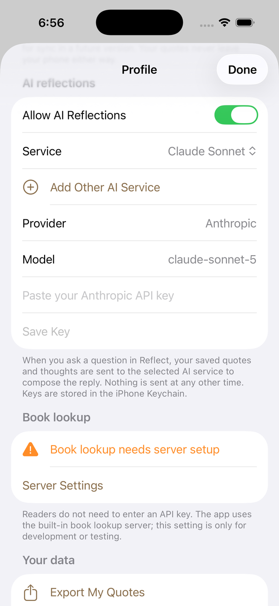
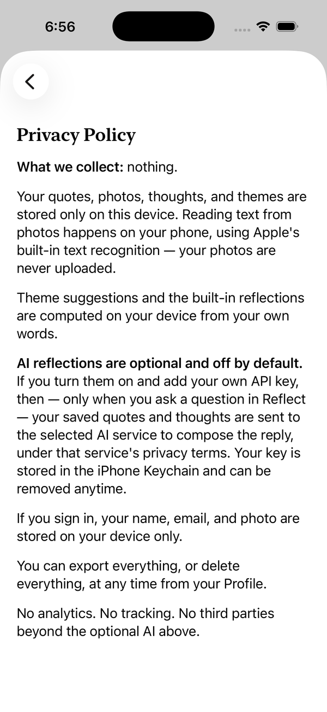

<p align="center">
  
</p>

<h1 align="center">Quotee</h1>
<p align="center"><em>A calm reading companion for iPhone. Save quotes, build a notebook, and think with what you've read.</em></p>

<p align="center">SwiftUI · SwiftData · Vision OCR · on-device retrieval (RAG) · FastAPI · LLM APIs</p>

> The source code is in a private repository. This page describes the product and its design. Code access is available on request.

---

## The problem

People save lots of passages from what they read, then lose track of them. They forget why a line mattered, miss the connections between books, and can't see how their own thinking has shifted over time. Most AI tools answer by summarizing. That sounds fluent, but it says little about *you* — the Barnum effect, in software form.

Quotee starts from the opposite principle:

> **The AI helps you understand yourself. It doesn't think, or write your feelings, for you.**

## How it works

**Save → Clippings → Notebook → Reflect**

1. **Capture.** Photograph a page, pick a screenshot or paste text. On-device OCR (English and Chinese) lets you tap the lines you want, like a highlighter, so you don't get the whole page dumped into the box.
2. **Clippings.** A low-pressure holding space. Nothing has to be filed right away.
3. **Notebook.** A bookshelf with custom covers, themes, your own "My Thoughts", search and a calendar look-back. It deliberately has no streaks.
4. **Reflect.** A conversation grounded in *your* notebook.

## Screenshots

<table>
  <tr>
    <td align="center" width="33%"><br><sub><b>Save</b> — camera, image or paste</sub></td>
    <td align="center" width="33%"><br><sub><b>Clippings</b> — save first, organize later</sub></td>
    <td align="center" width="33%"><br><sub><b>Notebook</b> — a shelf of the books you've quoted</sub></td>
  </tr>
  <tr>
    <td align="center" width="33%"><br><sub><b>Looking Back</b> — a quiet calendar, no streaks</sub></td>
    <td align="center" width="33%"><br><sub><b>Reflect</b> — "only a mirror; the reflection is yours"</sub></td>
    <td align="center" width="33%"><br><sub><b>Grounded answers</b> — source quote shown inline</sub></td>
  </tr>
  <tr>
    <td align="center" width="33%"><br><sub><b>AI reflection</b> — connects your quotes and notes</sub></td>
    <td align="center" width="33%"><br><sub><b>Opt-in AI</b> — choose provider, key in Keychain</sub></td>
    <td align="center" width="33%"><br><sub><b>Privacy, in plain words</b></sub></td>
  </tr>
</table>

## What makes Reflect different

| Principle | What it means in practice |
|---|---|
| **Grounded, with sources** | Every answer comes from retrieved quotes, books, themes and notes, and shows exactly which ones it used. |
| **Honest refusal** | When the notebook doesn't hold enough evidence, the assistant says so instead of forcing in loosely related quotes. |
| **Juxtaposition** | Puts two ideas from different books side by side when they share a theme, without deciding for you whether they agree or conflict. |
| **User-owned conclusions** | Once a conversation reaches real insight, the AI drafts a *reflection card*. Drafts never enter long-term memory until you edit or confirm them in your own words. |
| **Memory across conversations** | Confirmed cards become retrievable in future conversations and appear on a knowledge map of books, quotes, themes and reflections. |
| **Separated sources** | Optional web search is always labelled apart from your own notebook. Outside content is never passed off as your thinking. |
| **Private by default** | Data lives on the device. AI is opt-in, and each request sends only the few retrieved items rather than the whole notebook. |

The loop isn't "the AI writes a nice summary". It's:

```
save a quote → retrieve evidence → connect ideas → you form the understanding → confirm a card → it comes back next time
```

## Architecture

```
iOS app (SwiftUI + SwiftData, iOS 17+)
 ├─ Capture & OCR          Vision framework, tap-to-highlight line selection
 ├─ Local retrieval        filter → rank (relevance, personal notes, context, past reflections) → top-k
 ├─ Reflection engine      source-bound answers, refusal, juxtaposition, card drafting
 └─ AI layer               direct providers (keys in Keychain) or a self-hosted proxy
                                   │
                                   ▼
                       FastAPI backend (optional)
                        ├─ book search
                        ├─ notebook-grounded chat
                        └─ web-search-augmented chat
```

Retrieval, refusal and juxtaposition all run **fully offline**. The language model is an optional layer on top.

## Evaluation

Retrieval is tested separately from the UI, with a standalone diagnostics harness that runs against fixed data:

- exact-title and theme matching
- weighting of the user's own notes
- recall of confirmed reflection cards
- **correct refusal** on questions the notebook can't answer
- top-k limits and stable quote IDs
- juxtaposition only when two items share an explicit theme

Answer quality is reviewed by hand against a fixed question set. The review checks whether each claim is supported by the cited quotes, whether user words, AI inference and web content are kept apart, and whether reflection cards fire at meaningful moments instead of interrupting.

Metrics tracked: top-5 retrieval hit rate, citation accuracy, correct-refusal rate, card confirmation rate vs. heavy-edit rate, and offline fallback success.

## Status

A working prototype running on iPhone, built and iterated as a solo project.

---

<sub>© 2026 Meihui (Lily) Wu. All rights reserved. No part of this project may be copied, modified or redistributed without written permission.</sub>
